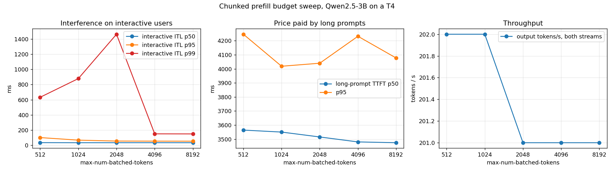

# chunkedprefill-lab

Chunked prefill scheduling experiments: how long-context prefill starves decode, and how chunk size trades TTFT against ITL under mixed load.

Project 8 of 15 in [inference-infra-portfolio](https://github.com/NomanJafar/inference-infra-portfolio).

## What this builds

Configure chunked prefill and measure TTFT and ITL under mixed prefill/decode load as chunk size changes.

## Why it matters

Long-context requests starve decode without scheduling control.

## Status

Done. Three T4 runs: run 1 was nullified by prefix caching (identical prompts), run 2 saturated the GPU, run 3 is the clean measurement. All three are kept under [`results/`](results/) with their post-mortems.

## What is in here

| Module | Purpose |
|---|---|
| `chunkedprefill_lab.analysis` | Server flags for a budget / chunking setting, the paired-stream rows (interactive ITL percentiles and interference ratio, long-prompt TTFT, combined throughput), Markdown table |
| `notebooks/kaggle_chunkedprefill.ipynb` | Two concurrent open-loop tokenbench streams (interactive: 64-token prompts, 128 out; long: 3,500-token prompts, 32 out), `unique` prompts so prefix caching cannot serve the prefill, budgets 512 → 8192 with chunked prefill on, 4096 with it off, interactive-only baselines |

## Results (Tesla T4, vLLM 0.31.0, Qwen2.5-3B-Instruct FP16, Kaggle, 2026-10-15)

### Run 3: below saturation (interactive 2 req/s, long prompts 0.1 req/s, 60 s per configuration)

| config | interactive ITL p50 | p95 | p99 | **max (the stall)** | interactive TTFT p50 | long-prompt TTFT p50 | p95 |
|---|---|---|---|---|---|---|---|
| budget=512 | 36 ms | 103 ms | 633 ms | **1.35 s** | 124 ms | 3.56 s | 4.25 s |
| budget=1024 | 35 ms | 69 ms | 879 ms | **2.10 s** | 120 ms | 3.55 s | 4.02 s |
| budget=2048 | 35 ms | 57 ms | 1462 ms | **3.49 s** | 123 ms | 3.52 s | 4.04 s |
| budget=4096 | 35 ms | 56 ms | 152 ms | **3.48 s** | 120 ms | 3.48 s | 4.23 s |
| budget=8192 | 35 ms | 55 ms | 151 ms | **3.81 s** | 123 ms | 3.47 s | 4.08 s |
| budget=4096, chunked off | 35 ms | 55 ms | 152 ms | **3.51 s** | 121 ms | 3.46 s | 4.09 s |
| interactive only | 34 ms | 52 ms | 62 ms | **0.10 s** | 112 ms | – | – |



### Run 2: the same sweep at 4 / 0.4 req/s, which saturated the GPU (both streams queued 15–20 s)

| config | interactive ITL p50 | p95 | p99 | **max (the stall)** | interactive TTFT p50 | long-prompt TTFT p50 | p95 |
|---|---|---|---|---|---|---|---|
| budget=512 | 184 ms | 621 ms | 711 ms | **1.38 s** | 19766 ms | 15.91 s | 26.54 s |
| budget=1024 | 121 ms | 1149 ms | 1322 ms | **2.05 s** | 16905 ms | 15.00 s | 23.75 s |
| budget=2048 | 122 ms | 1753 ms | 2331 ms | **3.65 s** | 15469 ms | 14.51 s | 22.07 s |
| budget=4096 | 121 ms | 2032 ms | 3924 ms | **4.34 s** | 20281 ms | 19.19 s | 27.38 s |
| budget=8192 | 122 ms | 203 ms | 7311 ms | **7.44 s** | 18652 ms | 17.56 s | 27.62 s |
| budget=4096, chunked off | 122 ms | 1467 ms | 3986 ms | **4.33 s** | 19068 ms | 16.61 s | 26.21 s |
| interactive only | 44 ms | 60 ms | 91 ms | **0.14 s** | 134 ms | – | – |

### What the numbers say

1. **The stall an interactive user suffers is the time to prefill one chunk, and the budget sets it.** In run 3 the worst inter-token gap went 1.35 s (budget 512) → 2.1 s (1024) → 3.5 s (2048 and above). With a budget of 4096 or more, or with chunking off, a 3,500-token prompt is prefilled in a single iteration and every decoding user waits the full ~3.5 s for their next token. That iteration time, ~1,000 prompt tokens per second, is what a 3B model's prefill costs on a T4.
2. **Small budgets trade one big stall for several smaller ones, and that moves the percentiles in opposite directions.** p95 ITL got *better* with larger budgets (102 → 55 ms) because there were fewer stalls, while the maximum got worse. At budget 512, 7 chunks per long prompt touched ~5% of all token gaps, so p95 and p99 both show them; at 4096 a single stall per long prompt touched under 1% of gaps and **p99 reads 152 ms while the true worst case is 3.5 s**. For this kind of interference, report the maximum or p99.9, not p99; the primer's "watch p99" was too optimistic for a long-prompt rate this low.
3. **The long prompts paid almost nothing for being chunked.** Their TTFT was 3.56 s at budget 512 and 3.47 s at 8192 (+2.5%): seven chunks interleaved with decode cost 90 ms over one monolithic prefill. CONCEPTS.md section 2 predicted a clear TTFT penalty for small budgets; on this GPU, where prefill compute dominates, it is in the noise. The honest knob setting for an interactive service on this hardware is therefore the *small* budget (512–1024): the long prompts do not notice, and nobody waits 3.5 s for a token.
4. **Chunked prefill off at budget 4096 behaved exactly like chunked prefill on at 4096**, as it should: both prefill the prompt in one iteration. (vLLM V1 refuses chunking off when the budget is smaller than `max-model-len`, so "off" is only reachable with a budget that makes it moot.)
5. **Under saturation the budget still orders the stalls (run 2: max 1.4 → 2.1 → 3.7 → 4.3 → 7.4 s) but TTFT becomes queueing**, 15–20 s for both streams, and the long-prompt side cannot be read. The 8192 row's 7.4 s maximum is two long prompts prefilled in one iteration.
6. **Throughput did not show the overlap benefit** (201–202 tok/s in every run-3 configuration): an open loop below saturation delivers exactly the offered load, so a throughput gain can only appear in a closed loop or at saturation, where run 2's 310–330 tok/s were likewise flat across budgets. The decode-plus-prefill overlap that Sarathi reports was not measurable here.

### Methodology notes, learned the hard way

Run 1 used one fixed 3,500-token prompt and vLLM's default prefix caching served every prefill after the first from cache (TTFT 185 ms for 3,500 tokens), so all budgets measured identically; `tokenbench --prompts unique` exists because of this run. Run 2 set the long-prompt rate at 0.4/s, four times what this GPU can prefill alongside the interactive stream.

### What was not measured

The overlap throughput gain (needs a closed loop at saturation with budget as the only variable); budgets below 512; longer interactive outputs, where a single stall is a smaller fraction of a user's experience; the same sweep on a GPU where prefill is fast enough that chunk overhead would show.

## Layout

```
CONCEPTS.md     the theory behind the project, written before the code
src/chunkedprefill_lab/   implementation
tests/          CPU-only tests, runnable on a laptop
notebooks/      GPU notebooks (Kaggle / Colab) that run the experiments and write results/
results/        measured numbers and plots
```

## Running

```bash
python -m venv .venv && source .venv/bin/activate
pip install -e ".[dev]"
pytest
```

GPU experiments run from `notebooks/`; each notebook clones this repo, installs it and writes its outputs to `results/`.

## Hardware notes

Developed against free-tier GPUs (Kaggle and Colab T4, 16 GB). Where a T4 limits what can be measured (no FP8, Turing-era kernels), the README says so rather than papering over it.

## License

MIT
